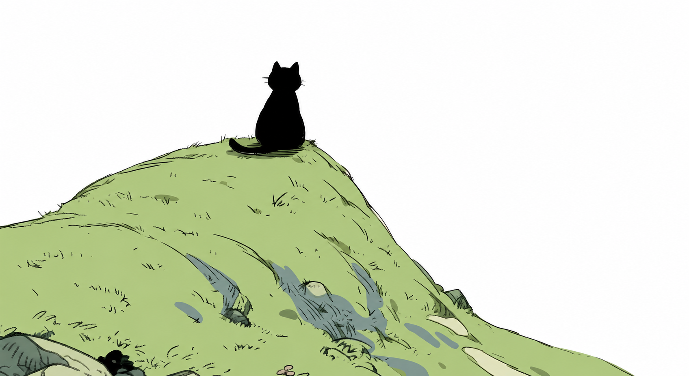

 
保持好奇，慢慢生长。

### Zhengbiwen

接近真理，接近现实。写一些自己想用的工具，把想法慢慢变成作品。 
桌面应用 · Android · 开发工具

### 作品

#### [ShellSpan](https://github.com/hi-fullmoon/ShellSpan)

跨平台 AI SSH 客户端，集成多标签终端、SFTP 文件管理与 AI Agent。 
桌面应用 · Rust

#### [息刻 · Xike](https://github.com/hi-fullmoon/Xike)

离线优先的 Android 心情日记，用文字、照片和语音记录此刻。 
Android · Kotlin

#### [AICommit](https://github.com/hi-fullmoon/AICommit)

用 AI 生成符合 Conventional Commits 规范的 Git 提交信息。 
命令行工具 · JavaScript

 

### 工具与配置

[Windows 全局热键](https://github.com/hi-fullmoon/HotkeyManager) · [macOS 全局热键](https://github.com/hi-fullmoon/HotkeyManager-mac) · [Neovim 配置](https://github.com/hi-fullmoon/nvim-config)
