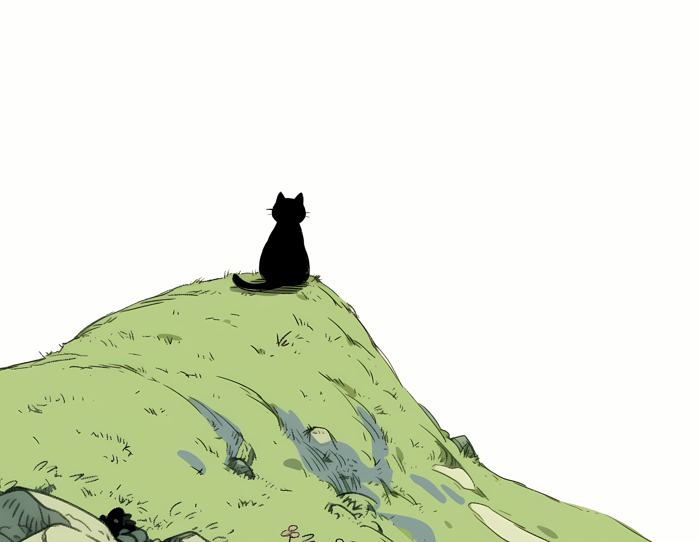

HI, I'M

# Zhengbiwen 🌙

**接近真理，接近现实。**

写一些自己想用的工具，把想法慢慢变成作品。

[项目](https://github.com/hi-fullmoon?tab=repositories) · [ShellSpan](https://github.com/hi-fullmoon/ShellSpan) · [息刻](https://github.com/hi-fullmoon/Xike) · [AICommit](https://github.com/hi-fullmoon/AICommit)

 

 

### 正在打磨的作品

从桌面到移动端，也写一点让日常开发更顺手的小工具。

| 项目 | 简介 | 技术方向 |
| :--- | :--- | :--- |
| [**ShellSpan**](https://github.com/hi-fullmoon/ShellSpan) | 跨平台 AI SSH 客户端，集成多标签终端、SFTP 与 AI Agent。 | 桌面 · Rust |
| [**息刻 · Xike**](https://github.com/hi-fullmoon/Xike) | 离线优先的 Android 心情日记，用文字、照片和语音记录此刻。 | Android · Kotlin |
| [**AICommit**](https://github.com/hi-fullmoon/AICommit) | 用 AI 生成符合 Conventional Commits 规范的 Git 提交信息。 | CLI · JavaScript |
| [**Athena**](https://github.com/hi-fullmoon/Athena) | 本地优先的 Android 日期应用，管理纪念日、倒数日与提醒。 | Android · Kotlin |

 

### 还有一些小工具

[Windows 全局热键](https://github.com/hi-fullmoon/HotkeyManager) · [macOS 全局热键](https://github.com/hi-fullmoon/HotkeyManager-mac) · [Neovim 配置](https://github.com/hi-fullmoon/nvim-config)

---

  
   
  保持好奇，慢慢生长。

